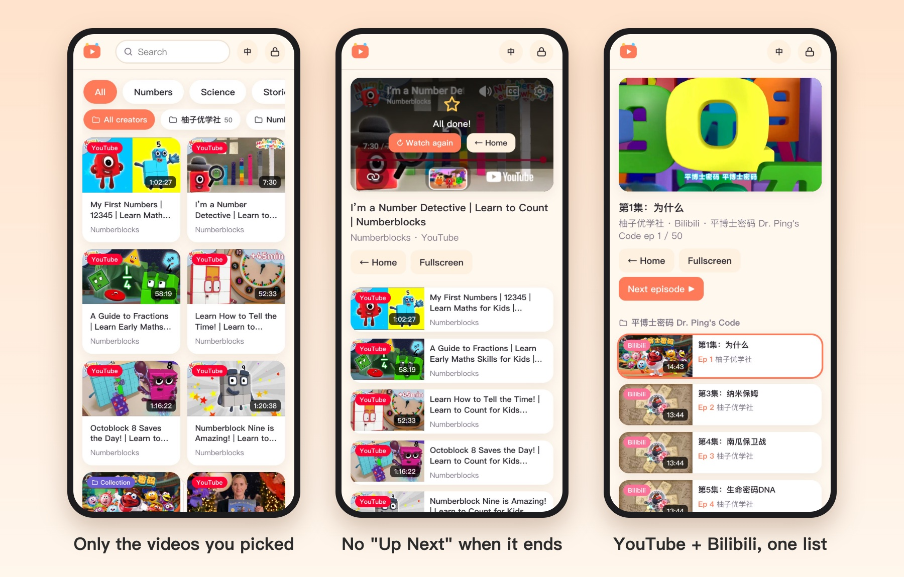

# DomiBuddy Lists · 朵米片单

*Kids' video lists, picked by parents. A [DomiBuddy](https://domibuddy.com) (朵米伙伴) product, formerly KidsTube.*

**Try it:** <https://lists.domibuddy.com> · free, open source (MIT), no sign-up

A kids' video site where parents choose exactly which videos their children can watch.

English | [中文说明](#中文说明)



## Why

Video apps for kids have three problems for parents:

- **You don't control what's on.** One cartoon leads to an endless feed of recommendations you never picked.
- **Ads and unrelated videos.** Pause, and the screen fills with thumbnails that pull the child somewhere else.
- **Content is scattered.** The good shows are split across YouTube, Bilibili, Tencent Video, Youku and iQIYI, each with its own app.

DomiBuddy Lists puts one list in front of the child: only the videos the parent added, from any of those sites, in one place.

## Highlights

- **Whitelist only.** Kids mode shows only videos in the library. The parent area is behind a 4-digit PIN.
- **One library, many sites.** YouTube, Bilibili, Tencent Video, Youku, iQIYI, Xigua, Vimeo, direct mp4 / m3u8 links, and videos in your own Baidu Netdisk (with the helper). Import whole collections, playlists, channels or Netdisk folders.
- **No recommendations or outbound links.** Player logos, titles and end-screen recommendations are covered; an optional per-site sandbox blocks links out of the player. Bilibili videos can play in DomiBuddy Lists's own player, with no Bilibili recommendations.
- **Privacy: data never leaves the device.** No server, no account, no analytics. The list and settings live only in the browser (localStorage); move them to another device with a JSON export.
- **Daily watch-time limit**, automatic next episode, and memberships you already pay for (sign in to each site in the same browser).
- **Works on phones and tablets.** Add it to the home screen. Chinese / English.

## Overview

- **Pure static website, no server.** Link resolving runs in the browser.
- **Data stays local.** Video lists and settings are stored only in the browser (localStorage) and are never uploaded.
- **Chinese / English.** Switch from the top bar or in Settings.

## Running and deploying

DomiBuddy Lists is just the static files in the `public/` folder:

- **Local preview:** `npm start` (Node 18+, no dependencies), then open <http://localhost:5173>. Devices on the same Wi-Fi can use the LAN address it prints.
- **Deployment:** upload `public/` to any static host, such as GitHub Pages, Cloudflare Pages, Vercel, or Nginx. Subdirectory deployment is supported. HTTPS is recommended.

## DomiBuddy Helper (userscript)

Browser cross-origin restrictions (CORS) stop a web page from reading data from sites such as Bilibili. The **DomiBuddy Helper** ([`public/kidstube-helper.user.js`](public/kidstube-helper.user.js)) is a userscript. With it installed, cross-origin requests go out through your userscript manager and use your own sign-ins in that browser. You don't need to copy cookies, and no server is involved.

| Device | Browser | Userscript manager |
| --- | --- | --- |
| Computer | Chrome / Edge / Firefox / Safari | Tampermonkey |
| Android | Firefox or Edge (Chrome for Android doesn't support extensions) | Tampermonkey |
| iPhone / iPad | Safari | Userscripts app (free, open source) |

Installation steps are in DomiBuddy Lists under 🔒 → Accounts.

Security design:
- The helper only runs on pages that contain `<meta name="kidstube-app">`.
- It only contacts the video sites listed under `@connect`.
- Each DomiBuddy address must be allowed by the user in a confirmation dialog the first time.

## What works with and without the helper

| Feature | Without helper | With helper |
| --- | --- | --- |
| Single YouTube video | ✅ title and thumbnail read automatically | ✅ |
| Single Bilibili video | ✅ title, thumbnail and duration read automatically (via Bilibili's JSONP endpoint) | ✅ |
| Single video from Tencent Video / Youku / Xigua / TikTok / Dailymotion | ✅ plays; parent enters the title | ✅ title, thumbnail, and duration read automatically |
| Vimeo, direct mp4 / m3u8 links | ✅ | ✅ |
| YouTube playlist (`list=`) or `/channel/UC…` import | ✅ first 200 videos, no durations (read through YouTube's embedded player); full list with a YouTube Data API key | ✅ no key needed |
| YouTube `@handle` channel import | ✅ requires a YouTube Data API key | ✅ no key needed |
| Several links pasted at once (a shared list) | ✅ each link is looked up as above | ✅ |
| Bilibili channel import | ❌ | ✅ |
| Short links (b23.tv…) | ❌ open the link and paste the full address | ✅ expanded automatically |
| Paid Bilibili series (番剧), iQIYI, Mango TV | Opens a window from the original site | Same |

Playback never needs the helper. Embedded YouTube and Bilibili players are loaded by the browser directly.

With the helper installed, Bilibili videos play in DomiBuddy Lists's own player by default. The helper fetches Bilibili's html5 mp4 address and the browser streams it directly. This works in Firefox for Android, where Bilibili's embedded player can't load video. It also shows no Bilibili recommendations and plays the next episode automatically. Members-only or paid videos fall back to the embedded player. The setting is under Settings.

## Other features

- **Kids mode:** shows only videos in the library, with group chips and search. The parent area is protected by a 4-digit PIN.
- **Collections:** a Bilibili video that belongs to a collection (合集) or has multiple parts (分P) offers "Add whole collection" — no helper needed. Bilibili collection links (`space.bilibili.com/<mid>/lists/<sid>`) and YouTube playlists (`list=`) are supported too. On the kids' home page a collection shows as one card that opens its episode list.
- **Next episode:** the player always has a "Next episode" button for collections. YouTube and direct video links count down 5 seconds and play the next episode (can be cancelled; can be turned off in Settings). The Bilibili player doesn't report when a video ends, so a "Next episode" prompt appears near the estimated end instead.
- **Channel folders:** inside each category, videos are automatically grouped into second-level folders by channel (YouTube channel, Bilibili uploader, etc.) (on both the kids' home page and the parent library).
- **More from this channel:** any video in the library (or a lookup result) can open its channel page so you can pick more videos to add.
- **Paste share text:** when the pasted text has extra words around the link (e.g. Bilibili "share" text), the link is extracted automatically and the title is pre-filled.
- **Stay-in-app lock:** invisible covers over player logos and titles; YouTube recommendations are covered when a video is paused or ends; optional strict sandbox.
- **Daily watch-time limit:** a parent can add 15 more minutes with the PIN.
- **Memberships / ad-free viewing:** sign in to each site in the same browser. YouTube Premium needs "Use my signed-in account" turned on.
  - Embedded players need third-party cookies allowed. On iPhone this means turning off "Prevent cross-site tracking" in Safari.
- **Sign-in status:** with the helper installed, 🔒 → Accounts shows whether this browser is signed in to Bilibili, YouTube, Tencent Video, Youku and iQIYI (with the nickname where the site provides one). It re-checks when you come back from the sign-in page.
- **Xiaohongshu and Douyin:** no longer supported. Xiaohongshu's website doesn't play content, and Douyin isn't a good fit for kids. Their links show an error, and any of their videos already in the library are hidden from kids mode; a parent can delete them in the library.
- **Phones:** responsive layout, add to home screen, and in-page fullscreen fallback on iPhone.
- **Backup / transfer:** export and import the list as JSON. Since data is stored per browser, this is how you move a list to a child's tablet.

## Files

```
public/index.html               Entry page
public/app.js                   Kids mode, player, parent area
public/resolver.js              In-browser link resolver (also runs in Node for testing)
public/bridge.js                postMessage bridge between the page and the helper
public/kidstube-helper.user.js  DomiBuddy Helper userscript
public/i18n.js                  Chinese / English strings
public/style.css                Styles
server.js                       Optional local preview server (static files only)
```

---

## 中文说明

朵米片单（DomiBuddy Lists）是朵米伙伴旗下的产品：家长精选的儿童视频片单。原名 KidsTube。

**在线使用：** <https://lists.domibuddy.com> · 免费、开源（MIT）、无需注册

一个由家长挑选视频的儿童视频站：孩子只能看到你加进白名单的视频。


### 为什么做这个

给孩子用的视频 App，对家长来说有三个问题：

- **片源控制不了。** 放一集动画，接下来就是一串你没选过的推荐。
- **广告和无关视频太多。** 一暂停，满屏都是别的视频封面，把孩子的注意力拉走。
- **好内容分散。** 好节目散在 YouTube、B站、腾讯视频、优酷、爱奇艺，每个平台一个 App。

朵米片单只给孩子一个片单：里面只有家长加进来的视频，不管来自哪个网站，都在同一个地方。

### 亮点

- **只看白名单。** 孩子模式只显示片单里的视频，家长后台有 4 位密码锁。
- **一个片单，多个网站。** 支持 YouTube、B站、腾讯视频、优酷、爱奇艺、西瓜视频、Vimeo、mp4 / m3u8 直链，以及你自己百度网盘里的视频（需要助手）。合集、播放列表、频道、网盘文件夹可以整个导入。
- **没有推荐，点不出去。** 播放器里的标志、标题和结束推荐都会被遮住；每个网站可以单独开启沙盒，屏蔽播放器里的外链。B站视频可以用朵米片单自己的播放器播放，没有 B站推荐。
- **隐私：数据不离开设备。** 没有服务器、没有账号、没有统计。片单和设置只存在浏览器里（localStorage），换设备用 JSON 导出 / 导入。
- **每日观看时长限制**、自动播放下一集，已有的会员照常可用（在同一个浏览器里登录各网站即可）。
- **手机、平板可用。** 可以添加到主屏幕。支持中文 / 英文。

### 运行和部署

朵米片单就是 `public/` 文件夹里的静态文件：

- **本地预览：** `npm start`（Node 18+，无依赖），然后打开 <http://localhost:5173>。同一 Wi-Fi 下的设备可以用它打印出的局域网地址访问。
- **部署：** 把 `public/` 上传到任意静态托管，比如 GitHub Pages、Cloudflare Pages、Vercel 或 Nginx。支持子目录部署，建议使用 HTTPS。

### 朵米助手（油猴脚本）

浏览器的跨域限制（CORS）不允许网页直接读取 B站等网站的数据。**朵米助手**（[`public/kidstube-helper.user.js`](public/kidstube-helper.user.js)）是一个用户脚本。装好后，跨域请求通过你的脚本管理器发出，使用你在这个浏览器里的登录状态。不需要复制 cookie，也不经过任何服务器。

| 设备 | 浏览器 | 脚本管理器 |
| --- | --- | --- |
| 电脑 | Chrome / Edge / Firefox / Safari | Tampermonkey |
| 安卓 | Firefox 或 Edge（安卓版 Chrome 不支持扩展） | Tampermonkey |
| iPhone / iPad | Safari | Userscripts（免费开源 App） |

安装步骤在朵米片单的 🔒 → 账号 页面里。

安全设计：
- 助手只在包含 `<meta name="kidstube-app">` 的页面上运行。
- 只访问 `@connect` 里列出的视频网站。
- 每个朵米片单地址第一次使用时，都要用户在确认框里允许。

### 装不装助手的区别

| 功能 | 不装助手 | 装了助手 |
| --- | --- | --- |
| 单个 YouTube 视频 | ✅ 自动读取标题和封面 | ✅ |
| 单个 B站视频 | ✅ 自动读取标题、封面和时长（通过 B站 JSONP 接口） | ✅ |
| 腾讯视频 / 优酷 / 西瓜视频 / TikTok / Dailymotion 单个视频 | ✅ 可以播放，标题由家长填写 | ✅ 自动读取标题、封面和时长 |
| Vimeo、mp4 / m3u8 直链 | ✅ | ✅ |
| 导入 YouTube 播放列表（`list=`）或 `/channel/UC…` 频道 | ✅ 前 200 个视频，不显示时长（通过 YouTube 嵌入播放器读取）；填了 YouTube Data API key 可读取全部 | ✅ 不需要 key |
| 导入 YouTube `@用户名` 频道 | ✅ 需要 YouTube Data API key | ✅ 不需要 key |
| 一次粘贴多个链接（片单） | ✅ 每个链接按上面的规则解析 | ✅ |
| 导入 B站 UP主 | ❌ | ✅ |
| 短链接（b23.tv 等） | ❌ 打开链接后粘贴完整地址 | ✅ 自动展开 |
| B站付费番剧、爱奇艺、芒果 TV | 在原网站的窗口中打开 | 同左 |

播放本身不需要助手，YouTube 和 B站的嵌入播放器由浏览器直接加载。

装了助手后，B站视频默认用朵米片单自己的播放器播放：助手获取 B站的 html5 mp4 地址，浏览器直接播放。这样在安卓 Firefox 上也能看（B站嵌入播放器在那里加载不出视频），也没有 B站推荐，并且会自动播放下一集。会员或付费视频会退回到嵌入播放器。这个选项在设置里。

### 其他功能

- **孩子模式：** 只显示片单里的视频，有分组标签和搜索。家长区由 4 位 PIN 保护。
- **合集：** 属于合集或有多个分P的 B站视频，可以"添加整个合集"，不需要助手。也支持 B站合集链接（`space.bilibili.com/<mid>/lists/<sid>`）和 YouTube 播放列表（`list=`）。在孩子首页，一个合集显示为一张卡片，点开是剧集列表。
- **下一集：** 合集视频的播放器上一直有"下一集"按钮。YouTube 和直链视频会倒数 5 秒后播放下一集（可以取消，也可以在设置里关闭）。B站播放器不会通知视频何时结束，所以会在估算的结束时间附近提示"下一集"。
- **频道文件夹：** 每个分类里的视频会按频道（YouTube 频道、B站 UP主等）自动分成二级文件夹（孩子首页和家长片单里都是）。
- **这个频道的更多视频：** 片单里的任何视频（或查询结果）都可以打开它的频道主页，挑更多视频加进来。
- **粘贴分享文字：** 粘贴的内容里除了链接还有其他文字（比如 B站的"分享"文案）时，会自动提取链接并预填标题。
- **防跳出：** 透明遮罩盖住播放器的标志和标题；YouTube 视频暂停或结束时盖住推荐；可选的严格沙盒。
- **每日观看时长限制：** 家长输入 PIN 可以再加 15 分钟。
- **会员 / 免广告观看：** 在同一个浏览器里登录各网站即可。YouTube Premium 需要打开"使用我登录的账号"。
  - 嵌入播放器需要允许第三方 cookie。在 iPhone 上，需要在 Safari 里关闭"阻止跨网站跟踪"。
- **登录状态：** 装了助手后，🔒 → 账号 页面会显示这个浏览器是否已登录 B站、YouTube、腾讯视频、优酷和爱奇艺（网站提供昵称时也会显示）。从登录页面回来时会自动重新检查。
- **小红书和抖音：** 已不再支持。小红书网页版无法播放内容，抖音不适合孩子观看。它们的链接会提示错误，片单里已有的这类视频在孩子模式中隐藏，家长可以在片单里删除。
- **手机：** 响应式布局，可添加到主屏幕，iPhone 上有页面内全屏的兜底方案。
- **备份 / 迁移：** 片单可以导出、导入 JSON。因为数据按浏览器存储，把片单搬到孩子的平板上就靠这个。

### 文件

```
public/index.html               入口页面
public/app.js                   孩子模式、播放器、家长区
public/resolver.js              浏览器内的链接解析器（也可以在 Node 里运行测试）
public/bridge.js                页面和助手之间的 postMessage 通信
public/kidstube-helper.user.js  朵米助手用户脚本
public/i18n.js                  中文 / 英文文案
public/style.css                样式
server.js                       可选的本地预览服务器（只提供静态文件）
```
